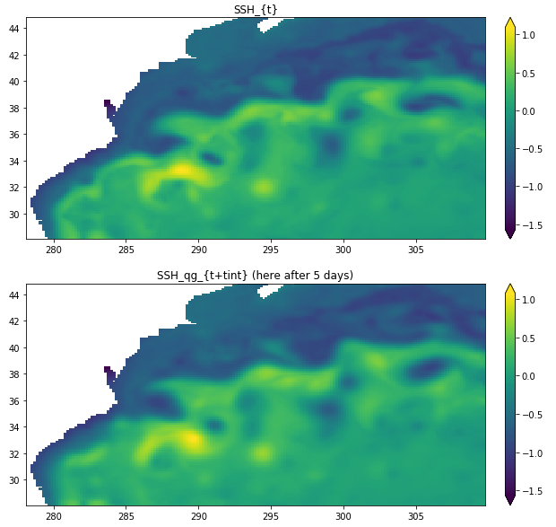

***** for QGNET the PyTorch version of the code https://arxiv.org/abs/1911.08856 please check the QGNET folder ******

***** a maintained, fully-featured PyTorch port of this model lives in [`QGNet_Pytorch/`](QGNet_Pytorch) *****

# qgsw-DI
Quasigeostrophic shallow-water model for Dynamic Interpolation of SSH

This is the supplementary material of the publication "Dynamic Interpolation of Sea Surface Height and Potential Applications for Future High-Resolution Altimetry Mapping", from C. Ubelmann et al., [pdf](https://journals.ametsoc.org/doi/abs/10.1175/JTECH-D-14-00152.1), please cite this article if you use the code in your works.

The backbone of the codes was written by Clément Ubelmann (ubelmann@cls.fr). I commented and prepared the codes for sharing, I also added a Jupyter notebook for illustration.

# Install

```bash
pip install -r requirements.txt
```

The code runs on Python 3 and NumPy 2.x. Modules are imported by bare name, so
run from the repository root (the notebook inserts the parent directory into
`sys.path` for you).

# Example

Please check the folder "notebooks" for more details



# Modules

| file | contents |
|---|---|
| `modgrid.py`  | `grid` class: metrics, Coriolis, land/boundary mask, 1-D index tables |
| `modelliptic.py` | `h2pv` (SSH -> PV) and `pv2h` (conjugate-gradient PV inversion) |
| `moddyn.py` | `h2uv` (geostrophy), `qrhs` (PV tendency), plus tangent-linear/adjoint variants |
| `qgsw.py` | forward propagator (explicit Euler on PV + one inversion per step) |
| `qgsw_tgl.py`, `qgsw_adj.py` | tangent-linear and adjoint models |

# PyTorch

| folder | contents |
|---|---|
| [`QGNet_Pytorch/`](QGNet_Pytorch) | maintained PyTorch port: same numerics (agrees to ~5e-16 over 5 days, ~1e-15 over 30 days), runs on CPU/CUDA/MPS, differentiable with autograd, optional neural velocity correction, pytest parity suite |
| [`QGNET/`](QGNET) | the original notebook from [arXiv:1911.08856](https://arxiv.org/abs/1911.08856), kept as published |

Use autograd rather than `qgsw_tgl.py` / `qgsw_adj.py` if you need gradients;
see the last point below.

# Gotchas worth knowing

* **`snu=0.` is not `snu=None`.** The land/boundary masking of the PV tendency
  (`rq[mask<=1]=0`) lives inside the `if grd.snu is not None` branch in
  `moddyn.qrhs`. Pass `snu=0.` to reproduce the published runs; `snu=None`
  leaves a non-zero tendency over the coastal halo.
* **`pv2h` defaults to `nitr=1`**, a single optimally-scaled steepest-descent
  step. The solve is deliberately under-converged and relies on the
  time-extrapolated guess `hguess = 2*h - hb`.
* **Boundary condition.** Rows with `mask==1` become identity rows whose RHS is
  the guess, so SSH on the boundary ring follows `2*h^n - h^{n-1}`; at step 0
  that equals the initial condition.
* **The border ring is asymmetric**: 2 cells at the low edges, 3 at the high
  edges (`mask[:2]`, `mask[:,:2]`, `mask[-3:]`, `mask[:,-3:]`).
* **`q` excludes planetary vorticity**; the beta effect enters as a separate
  explicit `-beta*v` term in `qrhs`.
* **`dy` carries the same `cos(lat)` factor as `dx`** in `modgrid`.
* **`moddyn.qrhs_adj` is only an exact transpose** of `qrhs_tgl` when the caller
  projects input and output onto `mask==2`. For exact gradients prefer the
  PyTorch port and autograd.
